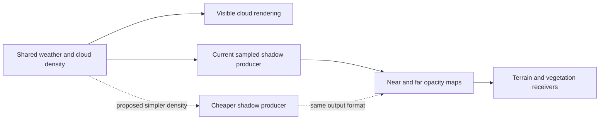

# Cloud shadow proxies

Assessment: 2026-09-15. This is a design investigation alongside the standalone
tree demo. Production cloud rendering and preset defaults have not been changed.

## Recommendation

Keep the existing separate cloud-opacity maps. First compare smaller maps and
slower updates using the controls already in the grave-key menu. If shadow-map
generation is still expensive, test a simplified density producer feeding the
same maps. This applies the useful part of tree sunblockers: the shape used for
shadows can be simpler than the visible object.

An opaque mesh or cutout card in the directional shadow atlas can approximate a
cloud outline, but it discards varying cloud thickness. It also consumes regular
shadow rendering work and does not remove the atlas allocation. Filtering an
opaque shadow softens its edges; it does not recover light passing through a thin
cloud.

## What the project already does

- [RingSunshineCloudBridge](../scripts/RingSunshineCloudBridge.cs) configures near
  and far GPU cloud-shadow maps separately from the directional-light atlas.
- [SunshineCloudShadowCompute](../addons/SunshineClouds2/SunshineCloudShadowCompute.glsl)
  samples cloud density along the sun direction and converts the accumulated
  density into opacity using exponential extinction. Its noise and weather
  parameters come from the visible cloud system, keeping the shadow attached to
  the same weather.
- The current producer writes both R/G integration contributions in the same
  dispatch. [The receiver](../materials/ring_cloud_shadow.gdshaderinc) combines
  them, projects using ring coordinates and receiver height, and blends near/far
  coverage.
- [SunshineClouds.gd](../addons/SunshineClouds2/SunshineClouds.gd) allocates one
  RG16F texture per cascade and retires replaced resources after outstanding GPU
  work. Shrinking a texture can briefly retain both old and new allocations.

## Experiment 1: use the existing controls

These are code defaults and an unvalidated candidate, not measured active runtime
settings. Saved overrides can change the effective values.

| Setting | Bridge code default | Candidate for comparison |
| --- | ---: | ---: |
| Near resolution | 1024 x 1024 | 512 x 512 |
| Far resolution | 256 x 256 | 128 x 128 |
| Near updates per second | 10 | 5 |
| Far updates per second | 0.5 | 0.5 |
| Vertical samples | 4 | 4 initially |
| Combined output texture storage | 4.25 MiB | 1.0625 MiB |

Texture storage is `4 * (near_width^2 + far_width^2)` bytes for RG16F, excluding
allocation overhead, retired textures, noise, visible-cloud render targets and
other resources. The candidate cuts these two output textures by 75%; that is
about 3.19 MiB, not a large reduction in total cloud-renderer memory.

Smaller maps also reduce generated texels. Reducing update rate changes recurring
generation work without changing allocated texture size. Neither percentage is
a measured frame-rate improvement, and cloud receiver shading still costs work.

The grave-key Clouds tab already exposes GPU near/far map resolution, radius,
update frequency and vertical sample count, with persistent settings. Its
generation and receiver profiling toggles let us separate their costs. Start
with resolution alone, then update frequency, then sample count, so each visual
and timing change has an identifiable cause.

## Experiment 2: cheaper shapes in the cloud-shadow producer

Use the shared large-scale density field or a small set of ellipsoids per
localized formation to estimate sun-ray thickness. Keep an opacity output:
`visibility = exp(-extinction * integrated_density)`.

- Preserve the existing cloud placement, wind, seeded weather and clock. A
  second independent cloud layout would make ground shadows drift away from the
  visible sky.
- Keep the current curved-ring projection and receiver-height adjustment.
- Retain coherent R/G output semantics, including clearing both channels when a
  shadow disappears. Changing to a single-channel format would require a
  coordinated producer/receiver change.
- For low presets, omit small density detail only in the shadow producer. A
  broad canopy outline is less demanding than nearby volumetric detail.
- Refresh after material sun, weather or origin changes; update-rate reduction
  must not leave a stale mask through a discontinuity. Retain resource retirement
  and near/far handoff behavior.

This is a proposed optimization, not implemented or benchmarked here. Fewer
samples through coarse shapes may produce detached shadows, overly dense storms
or unstable edges. Density simplification requires comparison against the visible
clouds, especially near sunrise and sunset.

## Cloud self-shadowing is a separate problem

Ground shadow masks describe how much sunlight reaches a receiving surface.
They do not fully describe how much light reaches a point inside a cloud. Saving
the secondary lighting marches of the visible volume would require additional
light-space depth/transmittance information or a layered opacity representation.

The current [visible-cloud compute shader](../addons/SunshineClouds2/SunshineCloudsCompute.glsl)
already has a `coarseSunLighting` path that omits fine erosion for directional
lighting while retaining it for other density uses. It still performs secondary
lighting samples. A cached light-space representation would be a further,
separate experiment whose cost includes generating and storing that cache.

As a primary-source example of that tradeoff, Epic documents cloud shadow maps
as a faster, less accurate alternative to secondary volume shadow marches, with
limitations for volumetric self-shadowing. That supports investigating the
approach; it does not establish a performance result for this Godot renderer.
[Epic: volume ray marching and shadow maps](https://dev.epicgames.com/documentation/en-us/unreal-engine/volumetric-cloud-component-in-unreal-engine?application_version=5.6)

## Validation before a production change

Use [the existing generation/receiver benchmark](../tools/sunshine_shadow_performance_benchmark.gd)
for whole-scene comparisons, with equal weather, camera, sun, warmup and sample
counts. Its comments explain the limits of viewport GPU timing for independent
compute work; retain dispatch counts and signed timing differences.

- [ ] Measure map-generation and receiver costs separately.
- [ ] Inspect clear sky, broken cloud, heavy storm and moving shadow edges.
- [ ] Inspect low sun, elevated terrain and near/far mask transitions.
- [ ] Inspect cloud entry, above-cloud views, and the opposite ring side.
- [ ] Check weather changes, floating-origin movement and cloud-shadow toggles.
- [ ] Confirm the user accepts the appearance before changing preset defaults.
