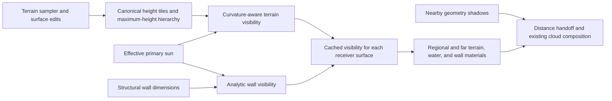

This plan adds sunlight shadows from distant mountains and ring walls, starting
with **Certified Ring**, then extending the same design to **Mega Ring**. That
priority was confirmed on 2026-09-23. The intended first release covers shadows
on distant terrain and visible water, plus terrain shadows on visible interior
wall faces.

## Terrain LOD shadow coverage follow-up (2026-09-30)

The runtime surface path now enables hardware casting on every active proxy tier through the local directional-light range. The previous policy chose only the finest tier and one coarse coverage tier, leaving visible intermediate terrain unable to cast. The range follows whichever sun/planet shadow lights are active; distant proxy tiers remain outside the hardware caster chain.

Certified terrain now receives independent sun and planet height masks. The planet producer reuses the existing terrain summary and runs asynchronously while planet illumination is active, rebuilding for direction, terrain-edit, and trace-setting changes. Pyramid edits wait for both readers. The planet receiver matches its light direction without a daytime multiplier, and its fade is bounded by the planet's local shadow range. Scaled-far receivers transform the direction into their renderer's coordinate frame. Near Terrain3D registers through its native material API and samples canonical UVs computed from the prepared window anchor.

The grave-key terrain-shadow enable, wall-caster enable, strength, trace, and fade controls govern these paths; the menu tooltip now identifies both sunlight and planet light. This does not add another large directional shadow atlas. The existing coarse-mask resolution, water/interior-wall receiver-height work, and Mega Ring limitations described below remain.

Validation passed: C# build, headless caster/handoff and geometry checks, controlled GPU sun/planet mask sampling, and native Terrain3D/proxy shading comparisons. The full runtime-generation gameplay fixture passed day, night, day return, and same-direction night revisit (`.godot/terrain_shadow_lod/4069435/report.json`), including native/proxy/scaled-far receiver bindings and transformed light directions. Its night handoff was 5,100–6,000 m for a 6,000 m planet atlas, closing the previous 6,000–8,000 m coverage gap. These checks establish integration and controlled shading response; they do not establish a performance budget or complete the mountain-shadow placement acceptance work below.

## Hitch investigation after the LOD coverage change (2026-09-30)

The reported airborne movement/panning hitch remains unconfirmed in the isolated fixture. A paused-light camera-pan run (`.godot/terrain_shadow_hitch/4345097/report.json`) showed about 0.45 ms more median GPU work with the full local caster chain at night. Its early day samples were still streaming and are not a valid policy comparison. A subsequent night flight over a 1.5 km route used current/sparse/sparse/current caster policies (`.godot/terrain_shadow_hitch/4278456/report.json`): median viewport GPU times were 7.69/7.20/7.17/7.64 ms, with no new draw-time pipeline compilations. The retained full-frame diagnostics reached 57.17 ms maximum; the original route loop's narrower render-wait timing excluded fixture movement overhead and must not be treated as complete frame time. The fixture uses a paused celestial clock and does not rule out periodic mask-update stalls in normal gameplay.

Diagnostics now separately time sun/planet mask builds as worker work and mask installation as main-thread work. Slowdown exports include per-LOD caster/streaming state, local shadow range, planet mask state, and pipeline compilation counters. No shadow coverage or quality reduction was made on the strength of these captures. A fresh report from the user's hitch location is needed to establish the actual regression. Build and shadow-coverage smoke passed; the broader diagnostics contract currently fails its synthetic buffer-eviction assertion, outside the capture-only changes made here.

## Initial implementation progress (2026-09-24)

The first Certified Ring prototype is implemented. Its existing whole-ring
height summary now stores a separate center receiver height, traces straight
sun rays through cylindrical ring space, and intersects both finite structural
walls. The runtime rebuilds the mask asynchronously when the effective sun,
terrain edits, or trace and wall settings change. Regional far terrain carries
an unwrapped canonical shadow UV across reanchoring and the ring seam. Terrain
and ocean materials apply this mask only to the primary sun's direct light.
The grave-key Shadows tab persists terrain and wall enable switches, strength,
trace steps and distance, and near/far handoff values.

The prototype passed a C# build; geometry and settings checks; GPU tests for
regional shadow UVs, terrain/storm overlap, water shading, and tree shadows;
and the rendered Certified performance diagnostic. On the tested RTX 4070,
the Certified run generated a 7,670 x 78 mask in roughly 190-245 ms per
background rebuild. That is a build-duration observation, not a frame-time
budget or a measured comparison with shadows disabled.

A disposable Certified A/B capture found roughly 1,900 shadowed interior mask pixels,
but its camera could not obtain a reliable view of the receiving terrain at
that canonical location. Its screenshots and JSON report are retained under
`.godot/terrain_macro_shadow_visual` with an `inconclusive_visual_capture`
status; they do not establish mountain-shadow placement in the game scene.

This is a coarse, whole-ring CPU prototype and does not satisfy the Certified
release or Mega Ring gates below. The next correctness work is a bounded dense
reference for narrow and off-screen casters, separate receiver heights for
visible water and interior wall faces, and conclusive visual A/B captures at the
listed sun angles and transitions. The production path then needs sparse, bounded GPU
tiles and measured budgets. Mega Ring still skips the legacy full-ring summary
and will use that sparse path rather than allocating a dense Mega-wide mask.

Use a hybrid: terrain heightfield tracing for mountains, mathematical wall
intersections for structural walls, and the existing geometry shadows for nearby
detail. Keep the terrain generator as the shared source of shape. Runtime cost,
quality defaults, and storage limits will be selected from measured results.

The current implementation supplies useful integration points:

| Existing component | What to reuse or address |
| --- | --- |
| [RingTerrainMinMaxPyramid](../scripts/Voxel/LOD/RingTerrainMinMaxPyramid.cs) | Height summaries and the existing directional mask. Its widely spaced trace samples can miss blockers. Base bounds sample corners and center, so they are not proven bounds on every procedural peak between those samples. |
| [RingTerrainGlobalLod](../scripts/Voxel/LOD/RingTerrainGlobalLod.cs) | Terrain sampling, edit notifications, and initial mask generation. Ordinary sun-uniform updates and edit refreshes do not rebuild the mask. The current summary builder skips circumferences exceeding its integer domain. |
| [RingTerrainMacroShadowProjector](../scripts/RingTerrainMacroShadowProjector.cs) | Material registration and physical fade distances. Extend its contract beyond one whole-ring texture. |
| [RingScaledFarViewport](../scripts/Voxel/LOD/RingScaledFarViewport.cs) | Whole-ring and regional far receivers. Regional materials currently disable the mask because global coordinate reconstruction loses precision. |
| [Terrain shadow include](../materials/ring_terrain_macro_shadow.gdshaderinc) | Shared receiver entry point. Replace float reconstruction with explicit, stable shadow coordinates where needed. |
| [Shadow composition](../materials/ring_cloud_shadow.gdshaderinc) | Existing cloud and geometry overlap behavior. Preserve its authored behavior while introducing explicit terrain ownership. |
| [Live tuning](../scripts/ui/RingLiveTuningDrawer.Shadows.cs), [settings persistence](../scripts/ui/GameplayShadowDefaults.cs), and [override validation](../scripts/Voxel/LOD/RingGraphicsQualityController.Shadows.cs) | Extend the current grave-key menu, validated overrides, atomic saves, reset behavior, and preset precedence. |

The proposed flow is:

1. **Establish the baseline and the coordinate contract.**

   Capture reproducible Certified Ring views of a mountain range, valley, wall
   edge, coastline, ring wrap, and opposite ring. Include low sun, high sun,
   moving sun, a storm, and flight through the far-viewport transition. Record
   hardware, render resolution, quality preset, active saved overrides, CPU/GPU
   frame times, and memory. Select a numeric feature budget from this baseline
   before selecting production quality defaults.

   Define tile addresses with 64-bit around-ring indices and double-precision
   canonical origins from the outset. Send bounded local offsets, tile/page
   identifiers, and receiver height to shaders. Carry the ring seam continuously
   across each mesh triangle and wrap only for lookup; interpolating directly
   between normalized coordinates near 1 and 0 is invalid.

   Extend mesh data deliberately: the proxy terrain already uses UV for coverage
   and UV2 for morph/skirt data. Choose an available custom attribute or a
   documented material-local mapping without overwriting those channels. Far
   regional mesh payloads currently need explicit shadow-coordinate data added.
   Use canonical physical heights and distances even when rendering applies
   scale factors or terrain underlay offsets.

   Completion gate: a debug tile/checker pattern remains attached to the same
   terrain through origin shifts, regional reanchoring, wrap crossings, material
   replacement, and main/far viewport transitions. Add Mega-scale coordinate
   tests now even though Certified is the first runtime target.

2. **Build a correct Certified Ring reference and first visual prototype.**

   Create a bounded reference tracer using double-precision straight rays in
   ring space. Convert each ray position to around/across position and radial
   height relative to the inside of the cylinder. Compare against a sufficiently
   dense discrete terrain heightfield. Use this reference to validate a faster
   implementation; avoid an unbounded whole-ring reference build at startup.

   Separate sampled receiver height from the maximum heights used to reject
   possible casters. Starting every receiver at its cell's highest mountain
   erases valley shadows. Define the sampled heightfield reconstruction and
   ensure its mip bounds are conservative for that representation. Compare its
   resolution against the actual visible mountain shapes before claiming it
   captures procedural peaks between samples.

   Add analytic wall intersections in the same prototype. For the current wall
   geometry, intersect the ray with each across-ring boundary plane and test
   the resulting radius against the wall's actual top/bottom bounds. Handle
   parallel rays, positive hit distance, self-intersection bias, and the two
   edges independently. Use structural dimensions from the world configuration.

   Start with hard visibility and a fixed sun, then sweep the sun continuously.
   Respect the ring's concave curvature: a local flat approximation or a planet
   formula with the wrong curvature sign can give incorrect long shadows.
   Explicitly distinguish the terrain relief trace range from the existing
   whole-ring day/night and eclipse model. Budget exhaustion is an unresolved
   query, not proof that the sun is visible.

   Completion gate: an isolated ridge shades its valley; both ring walls cast
   correctly placed shadows; near-vertical and grazing sunlight remain stable;
   a denser reference agrees within the chosen output-texel tolerance. The first
   reviewable visual milestone is mountains and walls casting onto terrain in
   one Certified Ring scene, with comparison and debug switches in live tuning.

3. **Turn the prototype into a bounded tile service.**

   Generate reusable terrain height tiles and a hierarchy of maximum heights.
   Trace hierarchically: skip a region only when its bounds prove the ray cannot
   hit, and descend/refine a possible hit to avoid treating an entire coarse
   cell as a solid mountain. Include borders and seam-aware neighbors for both
   filtering and traversal. The hierarchy should allow conservative maximum
   downsampling without raising the receiver surface.

   Use GPU compute to update cached visibility tiles, with the reference tracer
   retained for small correctness fixtures. Verify storage-format support on
   the active RenderingDevice. Reuse the project's render-thread and resource
   lifetime patterns. Avoid synchronous CPU readback in normal rendering.

   Select receiver tiles by visible detail and projected size. Request caster
   coverage along their sun rays, including off-screen terrain and other tiles.
   Separate output resolution from caster resolution. A low-resolution shadow
   output must not automatically erase a narrow ridge from the caster data.

   Give the service explicit CPU submission, GPU dispatch, upload, resident
   memory, and in-flight-work caps. Count height data, all mip levels, borders,
   page tables, receiver layers, old/new output buffers, and retired resources.
   Prefer a valid coarser result while finer tiles are pending; mark missing
   coverage explicitly. Keep legacy and disabled modes available for comparison
   and unsupported compute configurations.

   Refresh on effective sun direction, relevant terrain edits, receiver height,
   wall dimensions, world identity, and quality settings. Invalidate receivers
   downstream of edited casters, including across tile boundaries and the ring
   seam. Removing a summit must lower its cached bound as well as its visible
   geometry. Tag jobs with world, terrain, receiver, and lighting revisions so
   stale asynchronous results cannot replace current data.

   Use the same effective primary-sun direction as direct lighting, transformed
   into the canonical frame. Base update frequency on shadow movement in output
   texels and maximum acceptable age. Tighten it near low sun. Blend only small,
   compatible lighting changes; invalidate history after time jumps, teleports,
   incompatible edits, or cache reassignment. Origin rebasing alone should
   update bindings without rebuilding unchanged canonical height data.

   Completion gate: sun motion and edits update shadows without full-ring
   rebuilds or frame stalls; stale jobs are rejected; repeated travel and
   settings changes reach a bounded memory plateau; stopping and reopening the
   world releases or reuses resources correctly.

4. **Integrate every Certified Ring receiver and distance transition.**

   Connect the shared service to regional/global terrain, whole-ring scaled
   terrain, and the regional far bands that currently disable macro shadows.
   Register replacement materials immediately after asynchronous mesh rebuilds.
   Reuse the projector as the integration facade while making the new tile
   lookup and output semantics explicit. Only one terrain macro system should
   own each receiver at a time.

   Evaluate water at the displayed sea/lake/river surface height. A mask
   calculated for submerged ground cannot be reused blindly on its water
   surface. Cache separate receiver results wherever the material heights
   differ. Evaluate interior wall receivers at their actual height, using an
   around-position by wall-height visibility cache rather than stretching the
   ground mask vertically. Tag wall surfaces separately from the structural
   underside and cavity surfaces sharing the current shell mesh/material.

   Apply visibility to the primary sun's direct contribution, including any
   explicitly computed direct solar specular term. Leave ambient light,
   atmospheric scattering, decorative emission, and other lights under their
   existing ownership. Preserve existing cloud-overlap controls and validate
   their interaction with terrain shadows under dense storms.

   Derive the transition from effective cascade coverage and real meters.
   Preserve nearby object/contact shadows while handing overlapping terrain
   occlusion to the far system. Do not multiply two independent estimates of
   the same opaque terrain shadow and create a dark transition band. Test the
   composite result because geometry-shadow attenuation also contains trees
   and other objects that the heightfield cannot represent.

   Add edge filtering and controlled temporal smoothing after hard-shadow
   placement passes. Use the sun's angular size when estimating soft edges;
   measure any simpler distant approximation against that reference. Keep
   tuning for artistic softness separate from the height comparison bias.

   Completion gate: terrain, water, and interior wall faces agree on shadow
   placement; no visible wrap, tile, or viewport seam appears; terrain detail
   transitions do not produce obvious detachment; nearby trees and contact
   shadows retain their expected appearance.

5. **Finish live tuning, measurement, and Certified release defaults.**

   Extend the grave-key Shadows tab and the existing persistent override path as
   each feature lands. Expose mode, terrain/wall enable switches, quality or
   output texel scale, maximum terrain trace range, update rate and angular
   threshold, bias, softness, strength, and cascade transition distances. Keep
   advanced memory/work limits in an advanced group. Show effective values when
   hardware or a preset clamps a request.

   Add transient debug views for raw mountain visibility, wall visibility,
   combined direct visibility, tile level, coverage, cache age, and invalid
   queries. Diagnostics should show actual trace coverage rather than just the
   requested distance. Validate persistence across restart, preset reapplication,
   reset, and unsupported/out-of-range saved values.

   Extend existing performance telemetry with height generation, hierarchy
   build, shadow dispatch, upload, resident bytes, queue depth, tile misses, and
   oldest visible shadow age. Measure total frame impact as well as owned GPU
   intervals; dispatch timing alone omits receiver shading cost. Compare off,
   legacy, and new modes using identical cameras, lighting, and presets.

   Completion gate: the chosen Certified defaults meet the recorded frame-time
   and memory budgets on the stated hardware/resolution, pass the visual matrix,
   and retain stable frame times during travel and sun movement. Record measured
   results and the quality tradeoffs before making the new mode the default.

6. **Extend coverage and validate Mega Ring.**

   Keep the coordinate, receiver, and visibility contracts from Certified.
   Replace any remaining dense/global assumptions with sparse tile lookup and
   several coverage scales: regional detail where visible and a coarse whole-
   ring fallback with bounded storage. Page shadow data according to projected
   size; do not allocate an atlas proportional to Mega Ring's physical area.

   Audit every address, edit key, invalidation range, and page-table operation
   for narrowing to legacy 32-bit around-ring coordinates. Account for tiles at
   very distant parts of the ring and for off-screen casters at coarser levels.
   Use explicit error-controlled curvature calculations in local coordinates;
   subtracting a huge radius from a similar GPU float is insufficient.

   Stress opposite-ring views, long fast-travel routes, both wrap directions,
   repeated reanchoring, extreme sun angles, and independent wall dimensions.
   Completion gate: the same visual and correctness criteria pass at Mega scale
   while resident memory and per-frame work remain within configured caps.

Validation should exercise independent geometric cases as well as production
scenes:

| Area | Required evidence |
| --- | --- |
| Geometry | Flat surface, isolated ridge, narrow off-screen ridge, valley receiver, both walls, parallel wall ray, and grazing sun compared with a dense reference. |
| Coordinates | Ring wrap, tile borders, origin shift, regional reanchor, far/main handoff, and Mega positions beyond the legacy integer range. |
| Receiver height | Dry terrain, lake/sea water above ground, two heights on the same wall, and physical versus rendered underlay height. |
| Cache lifetime | Sun movement, fast time jump, add/remove terrain edit, cross-tile downstream invalidation, preset change, teleport, scene exit, and stale task completion. |
| Lighting | High/low sun, night, eclipse, dense cloud, secondary light, and nearby geometry-shadow overlap. |
| Performance | Warm steady state, cold/empty cache, sustained travel, sun animation, quality change, and memory plateau after repeated churn. |

Run a project build and the relevant existing settings, sun ownership, sun
stability, terrain/storm parity, tree-shadow, and far-view regression checks.
Add focused behavior and GPU visual fixtures for the new cases above. Headless
logic tests do not establish rendered shader correctness or GPU performance;
capture the visual and timing cases with the project's actual renderer.

Implementation ownership follows the repository workflow: the primary agent
plans bounded changes, personally reviews every edit, and runs the relevant
checks. Delegate nontrivial implementation to `gpt-5.6-terra` at low reasoning;
report unavailability rather than substituting another model. Land work in the
milestone order above, with explicit file ownership for each implementation task.

The first runtime deliverable is the small Certified scene in milestone 2. The
Certified feature is complete after milestone 5; Mega support is complete after
milestone 6. This document defines the work and its acceptance gates; it does
not contain measured performance results.

For algorithm background, [Optimally Fast Soft Shadows on Curved Terrain with
Dynamic Programming and Maximum Mipmaps](https://arxiv.org/abs/2005.06671)
demonstrates accelerated heightfield shadowing on curved planetary terrain. Its
performance results do not predict this game's cost, and its spherical geometry
must be adapted and checked for the ring's concave cylindrical surface.
