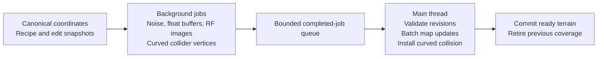

Ringworld Terrain3D runtime generation plan, prepared 2026-09-25.

This document is the portable reference for the proposed generator. It includes the selected requirements, research sources, architecture, implementation milestones, and acceptance criteria. Repository links are relative to this file so they remain usable when the checkout moves.

Implementation progress and validation results are tracked in the [runtime generation checklist](terrain3d-runtime-generation-checklist.md). The plan's performance and production-integration criteria remain open until that evidence is recorded.

Follow-up [terrain detail research](terrain-generation-detail-research.md), prepared 2026-09-29, investigates smooth mountains and weak local relief. The resulting [v3 detail implementation](terrain-generation-detail-implementation.md) adds foothills, spurs, optional Swiss shaping, and directional gullies through the existing preview and runtime-world paths. Its checks and CPU sampling measurements do not complete the full performance acceptance below.

### M6 gameplay streaming status

M6 is in progress. Both gameplay Terrain3D backends use private `WorkerThreadPool` jobs for exact float heights and RGBA8 biome maps while preserving their generation and save contracts. Each immutable cache tile is 128 × 128 samples at 2 m spacing (256 m per side); the 8 MiB default cache is primed from the synchronously loaded opening window, and a compatible 256 m axial recenter reuses six of nine tiles. Jobs prepare RF payloads and curved collision geometry; the main thread publishes region uploads and 32-cell collision tiles through two initial mesh owners that are prewarmed, with separate active/staged rebased world transforms. Default upload and collision budgets are 1 ms and 0.75 ms. They limit scheduling granularity only, because a native operation cannot be interrupted once started.

The rendered surface plus committed collision/query revision remains usable during preparation. Actual canonical velocity drives prefetch, and movement holds at supported coverage if a replacement is late. Edits apply immediately to the authoritative field and persist through the existing save path, wait 100 ms to coalesce replacement work, and retain committed collision/query state until replacement publication; public field queries can observe pending edits. The grave-key settings persist workers, prefetch, cache, upload budget, collision budget, and tile size separately from world definition settings. A guarded synchronous baseline is available only to `res://.godot/terrain-generation-tests/m6-*` fixtures for controlled comparison.

A repeatable travel fixture is available for sequential baseline and asynchronous runs with per-viewport CPU/GPU profiles. A clean 60 m/s route recorded fewer extreme intervals asynchronously, but it is not full acceptance; the checklist records the configuration, results, and limits. Earlier comparative benchmark figures are invalid because another game was running concurrently and must not be used for M6 acceptance. Full performance and human acceptance remain open; this status makes no 60 FPS or hitch-elimination claim. Mega support and caves remain outside this milestone.

### M5 implementation status

M5 now has an opt-in Certified-only gameplay backend, `surface_runtime_generation_v1`. Advanced launcher item 2 creates a world from the saved preview recipe or default recipe, applies the launcher seed, canonicalizes it through the shared C# authority, and freezes the recipe and contract in slot metadata and state. Existing M5 worlds require that exact definition and cannot convert from old worlds or mutate geography.

Its generator is v17; legacy terrain stays v16. The runtime policy is terrain -8,000 to +8,000 m, sea level 0 m, build ceiling 8,400 m, and structural wall top 10,400 m, with caves and natural overhangs disabled. It owns its state and edit files separately, supports fractional-height presentation consumers and the 2 m positive-diagonal curved collision field, and exposes read-only policy/hash diagnostics beside the retained brush controls.

The M1-M4 bounded asynchronous preview remains a separate budgeted streaming implementation. M6 applies the same bounded publication approach to runtime-generation gameplay, while full-stack performance and 60 FPS acceptance remain open. This status does not claim near Terrain3D macro, cloud projector, or atmosphere-material integration is complete.

This plan targets an isolated preview of a new Ringworld surface generator, followed by deliberate integration into the shared terrain pipeline. The selected requirements are the curved Ringworld, a 2 m horizontal sampling interval, and a desktop RTX 4070 at 1920 x 1080 with at least 60 FPS. Heights span -8,000 m to +8,000 m relative to sea level. Milestones 1–4 are implemented in the isolated preview; performance targets and production integration remain unaccepted. The architecture below records the design and the original starting point; the checklist records current implementation evidence.

The production target CPU and maximum gameplay travel speed are unspecified; local validation hardware is recorded in the checklist. Initial traversal cases should use 12 m/s, 60 m/s, and 108 m/s; the last case matches the isolated pilot's current maximum base speed of 60 m/s multiplied by its 1.8 sprint factor. These do not establish a maximum for production flight. Use actual velocity for prediction and add the production flight envelope to acceptance before integration.

The original M1–M4 recommendation was a deterministic GDScript height model, a coarse regional preview, and a small playable patch using the existing curved surface bridge. Streaming optimization follows measured sampling, upload, and collision costs. M5 now uses the shared C# authority for its frozen gameplay definition and GDScript bulk wrapper; this identity choice does not establish a C# performance advantage over the M1–M4 preview.

The checkout was inspected on 2026-09-25. Its relevant starting points are:

| Existing component | Verified behavior and implication |
| --- | --- |
| [Plugin configuration](../addons/terrain_3d/plugin.cfg) and [native provenance](../third_party/Terrain3D/PROVENANCE.md) | Terrain3D 1.0.2, pinned to upstream commit `0077405b52e353c5e5dc3a094e7ede49833ba6fe`, with a Windows culling patch for curved rendering. Preserve this patch. |
| [RingTerrain3DSurface.cs](../scripts/Terrain/Surface/RingTerrain3DSurface.cs) | Generates a 3 x 3 window of 128 x 128 height images at 2 m spacing. Generation, pixel packing, nine imports, and curved collision rebuilding are synchronous. |
| [RingSurfaceHeightField.cs](../scripts/Terrain/Surface/RingSurfaceHeightField.cs) | Canonical 2 m lattice, floating-point heights, and sparse absolute player edits. Preserve its coordinate and persistence contract. |
| [RingSurfaceFrame.cs](../scripts/Terrain/Surface/RingSurfaceFrame.cs) | Canonical-to-local curved mapping and anchor height. Native planar collision is disabled by the surface bridge. |
| [RingTerrainSampler.cs](../scripts/Voxel/Phase3/RingTerrainSampler.cs) | Shared procedural definition, generator version 16, periodic ring sampling, existing coasts/hydrology, and a separate precision-safe tiled path. A near-only replacement would disagree with distant terrain and other consumers. |
| [CertifiedRingScale.cs](../scripts/Voxel/Core/CertifiedRingScale.cs) | Approximately 5,000 km radius, 318 km width, sea level 0 m, terrain ceiling 8,000 m, routine summit ceiling 5,200 m, exceptional summit 7,600 m, and 400 m build clearance. |
| [VoxelChunkGridManager.SurfaceTerrain.cs](../scripts/Voxel/Phase2/VoxelChunkGridManager.SurfaceTerrain.cs) | The existing edit bridge to distant LOD uses integer height snapshots. RF images alone do not make this path preserve fractional heights. |
| [RingLiveTuningDrawer.SurfaceTerrain.cs](../scripts/ui/RingLiveTuningDrawer.SurfaceTerrain.cs), [surface settings](../scripts/ui/GameplaySurfaceTerrainSettings.cs), and [surface defaults](../scripts/ui/GameplaySurfaceTerrainDefaults.cs) | Existing grave-key menu and persistence conventions to extend. |

Related repository context is recorded in the [current Terrain3D surface integration](terrain3d-surface-port.md) and the [earlier mountain terrain brainstorm](mountain-terrain-overhaul-plan.md). The implementation status of this plan is defined by its own unchecked acceptance criteria below.

The requested API names need updating. For this version, the data owner is `Terrain3DData`, reached through `terrain.data`; regions are `Terrain3DRegion`. Use `update_maps()`, including its changed-region mode. Treat `Terrain3DStorage` and `force_update_maps()` as legacy interfaces rather than new dependencies. [Terrain3DData API](https://terrain3d.readthedocs.io/en/stable/api/class_terrain3ddata.html)

For a planar application, current native collision is managed through `Terrain3DCollision`, including `update(rebuild)`. This project must instead update its custom curved collision representation using the same committed heights as rendering. A call to the planar collision API cannot reproduce the shader's ring deformation. Map updates and physics publication are separate operations; neither is a general GPU/physics synchronization barrier. [Terrain3DCollision API](https://terrain3d.readthedocs.io/en/stable/api/class_terrain3dcollision.html)

Real geography gives useful constraints on the distribution and horizontal scale of the terrain:

| Real reference | Sourced baseline | Consequence for this generator |
| --- | --- | --- |
| Mean ocean depth | Approximately 3,682 m. [NOAA](https://oceanservice.noaa.gov/facts/oceandepth.html) | Typical basins should be substantially shallower than the deepest allowed trench. |
| Abyssal zone | Approximately 3,000-6,000 m below sea level. [NOAA Ocean Exploration](https://oceanexplorer.noaa.gov/ocean-fact/what-are-abyssal-plains/) | Broad deep seafloor can occupy this range; trenches require a separate narrow, rare mask. |
| Challenger Deep | Approximately 10,935 m. [NOAA](https://oceanservice.noaa.gov/facts/oceandepth.html) | The requested -8,000 m is an intentional world limit, not Earth's deepest value. |
| Everest | 8,848.86 m. [Nepal Department of Tourism](https://www.tourismdepartment.gov.np/files/statistics/46.pdf) | +8,000 m is a deliberately capped extreme; do not stretch every ordinary ridge toward it. |
| Southeast Tibet | Example valley floors around 4,300 m and mountains around 5,800 m, in a roughly 49.8 x 33.6 km radar scene. [NASA](https://visibleearth.nasa.gov/images/52407/southeast-tibet-mountains) | Elevation and local ruggedness must be independent. A high basin can remain smooth. The image footprint is not a measurement of ridge spacing. |

These references support the general shape, not exact noise frequencies. The following parameters are proposed starting values for a preview, not measured geographic statistics or finalized world settings:

| Field | Approximate feature scale | Initial approach |
| --- | --- | --- |
| Continental land/ocean structure | 150-600 km | Low-octave FastNoiseLite fBM; start near a 300 km base scale. |
| Mountain belt/uplift | 30-150 km | Independently seeded, gently warped field; start near 80 km. |
| Major alpine ridges | 2-15 km | FastNoiseLite `FRACTAL_RIDGED`; start at an 8 km base scale with 4 octaves. |
| Valley corridors | 1-8 km | Smooth valley mask that suppresses uplift and high-frequency detail. |
| Secondary alpine relief | 100-800 m | About 15-120 m amplitude, restricted to the mountain/ridge mask. |
| Geometric microdetail | 16-64 m | About 1-6 m amplitude, restricted to exposed upper ridges. |

Frequency is expressed in inverse meters; `1.0 / base_scale_m` is the starting convention, not an exact measured wavelength. With lacunarity 2, each octave halves the characteristic scale. Check the highest octave against sample spacing. At 2 m spacing, start with a shortest geometric feature scale of at least 16 m, and use material detail for smaller texture features. The choice of noise algorithm, fractal type, octave count, gain, lacunarity, warp, and independently derived seed must all be explicit. [FastNoiseLite API](https://docs.godotengine.org/en/stable/classes/class_fastnoiselite.html)

Horizontal extent matters as much as elevation. A 6,500 m rise from a 1,500 m foothill to an 8,000 m summit requires about 36.9 km of horizontal run at a constant 10-degree slope, or 17.9 km at 20 degrees (`run = rise / tan(angle)`). These are geometric examples, not proposed uniform mountain slopes. They show why packing the full height range into a few kilometers creates giant walls. A coarse preview should cover roughly 256-512 km around the ring and its 318 km width, with a movable 2 m detail window. Start the overview at 512 m samples; refine selected areas rather than allocating a regional 2 m heightmap.

The numeric contract is a minimum of 32-bit height precision throughout the new height-generation path. GDScript `float` arithmetic is actually 64-bit; preserve that precision for calculations and coordinate reduction. Pack height samples into `PackedFloat32Array`, then `Image.FORMAT_RF`. Standard-build `Vector3` coordinates remain 32-bit, so canonical positions must remain integer/double until reduced to a bounded local frame. [Godot float API](https://docs.godotengine.org/en/stable/classes/class_float.html)

| Encoding | Height quantization for the specified range |
| --- | --- |
| 8-bit unsigned normalized across 16,000 m | About 62.745 m between levels. |
| 16-bit unsigned normalized across 16,000 m | About 0.244 m between levels. |
| 16-bit floating point storing meters near 8,000 m | About 4 m between adjacent values. |
| 32-bit floating point storing meters near 8,000 m | About 0.000488 m, or 0.488 mm, between adjacent values. |

These are encoding calculations, not measured rendering accuracy. Height quantization, horizontal tessellation, noise-coordinate precision, physics precision, and camera depth precision are separate. Converting an already quantized image to RF cannot recover detail. `FORMAT_RF` is a single 32-bit floating-point channel. Keep height caches and saves in a lossless float-preserving representation and disable Terrain3D's optional 16-bit height saving if native region persistence is used. Color/biome maps can retain their appropriate existing formats. [Godot Image API](https://docs.godotengine.org/en/stable/classes/class_image.html), [Terrain3DRegion API](https://terrain3d.readthedocs.io/en/stable/api/class_terrain3dregion.html)

The height model will retain `calculate_1to1_height(x: float, z: float) -> float`, with a precise meaning: `x` is canonical distance around the ring, `z` is canonical distance across it, and the result is meters relative to sea level. They are not the rotated scene's global X/Z components. Sampling has no scene access, frame dependence, random-number consumption, resource mutation, or dependence on which region was generated first.

Its composition should follow this order:

1. Resolve the canonical domain and wrap using integer/double arithmetic. Sample every field through the same periodic coordinate convention. Include warping in the seam tests. Preserve the existing Certified path first and evaluate its small-scale precision; do not silently replace the current noise domain. Mega remains outside the first preview's acceptance scope.
2. Sample continentalness, mountain-belt strength, valley influence, and trench influence from independently seeded FastNoiseLite fields. Do not interpret a raw noise value of 0.7 as 70% of world area: use sampled coverage histograms to calibrate thresholds.
3. Map continentalness through an explicit smooth elevation curve. Include ordinary basin depths, the -1,000 m marine/lowland transition, a coastal shelf, sea level, and the +1,500 m lowland/alpine transition. Use smooth interpolation with compatible endpoint derivatives. Avoid hard `if height < threshold` discontinuities.
4. Apply exponential flattening to relief above each basin floor. Preserve sea level as a separate control point so flattening does not accidentally submerge the intended plains.
5. Apply regional mountain foundation and ridged uplift. Broad uplift locates ranges; the ridge field shapes relief within them; the valley field cuts broad smooth passages and can leave elevated valleys smooth.
6. Add secondary relief and microdetail through a peak mask computed from the pre-detail height, mountain-belt strength, ridge strength, and valley suppression. Skip the expensive detail fields when their mask is zero.
7. Keep the combined procedural result inside -8,000 to +8,000 m by allocating uplift, trench, and detail headroom. The final clamp is a numerical guard, not the normal mechanism that creates flattened summit caps. Track how frequently it activates.

For exponential flattening, define `F(u, k) = (exp(k*u) - 1) / (exp(k) - 1)` for `u` in [0,1], with the limiting value `F(u,0) = u`. Start with `k = 3`; `F(0.5,3)` is about 0.182. A land interval from 0 to 1,500 m then has a midpoint around 274 m rather than 750 m. Applying the same formula across the entire -1,000 to +1,500 m interval would put its midpoint around -544 m, which is why the sea-level anchor is necessary. Precompute the denominator for an immutable recipe. A tunable power curve is a simpler alternative if it produces the desired shape more cheaply in profiling.

For continuous three-zone composition, let `L` be a smooth land-transition weight and `A` a smooth alpine weight, both in [0,1]. The normalized weights can be `w_sea = 1-L`, `w_low = L*(1-A)`, and `w_alpine = L*A`. Blend bounded sea, lowland, and alpine candidate heights whose transition endpoints and slopes agree. The continental transfer curve and these weights must be designed together, with tests at each boundary; independently lerping arbitrary ocean and mountain heights is insufficient.

A candidate detail mask is `w_alpine * smoothstep(2000, 4500, macro_height) * ridge_crest_weight * (1-valley_weight)`. The 2,000/4,500 m values are proposed tuning defaults. With no alpine or crest contribution, or in a fully protected valley basin, the microdetail is exactly zero. A high plateau therefore does not automatically become jagged. Normalize the already-ridged FastNoiseLite output once; do not apply a second accidental ridged transform. This is artistic terrain synthesis, not hydraulic erosion or a guarantee of connected drainage. Existing hydrology requires its own integration and coastline tests.

The data flow separates background preparation from publication on the main thread:



In Markdown viewers without Mermaid support, the sequence is: immutable coordinate/recipe/edit inputs -> private background generation -> bounded completed results -> main-thread revision checks and staged upload/collision installation -> publication and retirement of previous coverage.

The GDScript structure should be small and explicit:

| Proposed component | Ownership and contract |
| --- | --- |
| `TerrainGenerationRecipe` (`Resource`) | Editable settings on the main thread; seed, generator identity, height bounds, field scales, flattening, ridge and detail settings. Snapshot before scheduling work. |
| `CanonicalNoiseDomain` (`RefCounted`) | Pure coordinate reduction/wrapping and noise-coordinate mapping; no scene or Terrain3D references. |
| `TerrainHeightModel` (`RefCounted`) | One private set of FastNoiseLite instances per active job or exclusively leased context. Exposes `calculate_1to1_height(x: float, z: float) -> float`. |
| `TerrainRegionJob` (`RefCounted`) | Owns one immutable input snapshot and private output buffers. `run() -> void` records a typed result/status; workers do not modify the scheduler. |
| `TerrainRegionResult` (`RefCounted`) | Canonical region key, recipe/edit/frame revisions, RF payload, height bounds, timings, and optional collider vertex data. Immutable after publication. |
| Generation scheduler | Extends the existing surface lifecycle: priority, bounded pending/in-flight/ready work, completion polling, cancellation, cache eviction, and retirement. No second world streamer. |
| Region commit adapter | Main-thread-only installation into the existing `RingTerrain3DSurface` and custom collider. Checks revisions and maintains matching render/collision coverage. |

The existing C# surface bridge remains the scene/physics owner. Cross-language handoffs should transfer complete region results rather than call between GDScript and C# once per height sample. Before production integration, choose one authoritative height implementation for all consumers. If the validated GDScript reference is promoted into a bulk C# or native sampler, require parity fixtures and make the compiled implementation the shared runtime source; do not maintain divergent near and far terrain definitions.

A worker fills a pre-sized, row-major `PackedFloat32Array`, tracks finite values and min/max, and packages it into RF. One region is one scheduling unit initially, not one task per sample. An illustrative packing boundary is:

```gdscript
static func heights_to_rf(samples: PackedFloat32Array, side: int) -> Image:
    assert(side > 0 and samples.size() == side * side)
    return Image.create_from_data(
        side, side, false, Image.FORMAT_RF, samples.to_byte_array()
    )
```

This snippet is a planned interface, not a claim that the pipeline has been implemented or tested. Scalar loops still execute on the CPU, but in background jobs. Bulk packing avoids a GDScript `Image.set_pixel()` call for each height. Byte conversion copies data, and image creation/upload can involve further copies; this is not a zero-copy path. Keep private CPU images separate from GPU textures. [PackedFloat32Array API](https://docs.godotengine.org/en/stable/classes/class_packedfloat32array.html)

Every sample is addressed by a canonical integer lattice index before conversion to meters. A region contains exactly N x N native texels and advances by N samples, not N-1. Adjacent region edge texels represent adjacent positions, not duplicate positions. Derivatives and collision tiles may need an extra halo or shared boundary row; obtain it from the same canonical lattice and crop it from the native image. Test both positive and negative coordinates using floor division, region corners, the circumference wrap, and every rebase orientation.

Canonical heights remain absolute elevations. The current renderer stores `height - frame.anchor_height` in its local height images; retain that explicit common offset for all regions in a window. Cache canonical data separately from frame-specific RF/collider payloads. On a frame change, reuse canonical samples and repack/project in background jobs as needed. Never normalize each region to its own min/max. A missing neighbor is not a zero-height sample.

At 128 x 128 samples, one RF height image contains 65,536 bytes (64 KiB) and represents a 256 m region pitch at 2 m spacing. Nine images contain 576 KiB of height payload for the current 768 m window. This excludes control/color maps, canonical and staging copies, GPU arrays, clipmap geometry, collision acceleration structures, and caches. Measure total CPU/GPU memory rather than treating height payload size as total terrain cost.

The pinned native `import_images()` implementation always creates and scans a temporary height image, including when offset is 0 and scale is 1, then slices maps and updates region arrays. This explains why using it once for each region is not automatically the fastest runtime path. Its null control/color inputs also create defaults, so repeated imports should not be used as an edit mechanism that is expected to preserve painted maps. [Pinned Terrain3D implementation](https://github.com/TokisanGames/Terrain3D/blob/0077405b52e353c5e5dc3a094e7ede49833ba6fe/src/terrain_3d_data.cpp#L796)

The main-thread commit plan is:

1. Validate job identity, expected byte count/format, finite height bounds, canonical key, and recipe/edit/frame revisions before touching resident resources. A stale result can be discarded or reused only as a canonical cache entry with a compatible recipe; it cannot overwrite newer edits.
2. For new regions, configure `Terrain3DRegion` maps, add a bounded batch with `data.add_region(region, false)`, then perform the necessary map update once for that batch. Preserve/default control and color maps explicitly. Region-set changes may require texture-array reconstruction.
3. For existing regions, prefer same-format `Image.blit_rect()` into the resident height image so cached image references remain valid. Consider replacing the image only after auditing consumers of the cached map arrays. Keep control/color maps intact. Update region height bounds, mark `edited`, call `data.update_maps(Terrain3DRegion.TYPE_HEIGHT, false, false)` once for the commit batch, and clear the consumed `edited` flags. Maintain `modified` independently when native persistence needs it.
4. Refresh aggregate height bounds for correct culling; avoid a recursive scan of every region for every edit. Test the direct-map path's min/max and dirty-state behavior against the pinned addon.
5. Stage curved collider replacements from the same committed sample revision. Install at a safe main-thread physics boundary, confirm usable coverage, then retire the old representation. Route height queries and proxy exclusion through the committed revision. Player edits that are pending installation must not create contradictory collision/query ownership.

Terrain3D has a bounded native region index map. Keep it as a local presentation window over the canonical ring rather than trying to address the whole circumference with ever-increasing native region coordinates. Reuse the existing frame and rebase design. [Terrain3DData region indexing and map updates](https://terrain3d.readthedocs.io/en/stable/api/class_terrain3ddata.html)

Thread safety follows ownership, not a global mutex around noise sampling. Jobs own their FastNoiseLite objects, arrays, images, and recipe snapshots until completion. A worker never accesses live Terrain3D data, shared edit dictionaries, active nodes, GPU texture readback, or the physics world. Shared queues/cancellation state require short mutex-protected operations; generation must happen outside locks. Avoid shared mutable resource caches and do not disable thread-safety checks. [Godot thread-safe APIs](https://docs.godotengine.org/en/stable/tutorials/performance/thread_safe_apis.html)

Use `WorkerThreadPool` initially with a bounded number of active region jobs, starting provisionally at two and profiling two versus four after recording the CPU. Poll `is_task_completed()` from the main thread, then call `wait_for_task_completion()` for completed tasks to reclaim task resources before reading/publishing results. Do not wait for unfinished tasks in the gameplay frame loop. Every task, including discarded work, must eventually be joined. Stop accepting work, request cooperative cancellation, and join retained tasks during controlled teardown. A scene-owned Node should not be the object captured by a long-running job. [WorkerThreadPool lifecycle](https://docs.godotengine.org/en/stable/classes/class_workerthreadpool.html)

Maintain an explicit state sequence: requested -> generating -> CPU ready -> staged -> collision ready -> committed -> retired. Keep an old valid window/collider during replacement. Use recipe, edit, and frame epochs to reject late completions. Batch slider changes, edits, and rebase requests; check cancellation between row groups rather than locking every sample. Cap queued jobs, completed results, resident cache bytes, and staged windows so fast travel cannot produce an unlimited backlog.

Prioritize near-player collision coverage, then the predicted movement corridor, then surrounding visual regions. Predict from actual canonical velocity, with a formula such as `lookahead >= speed * p99_total_readiness_latency + safety_margin`. Total latency includes queue time, generation, packing, upload scheduling, and collider installation. Teleports need a destination staging/loading path; ordinary prefetch cannot guarantee readiness at an arbitrary destination.

The current collider spans approximately 192 m on each side of its anchor and the surface normally recenters after about 128 m. The roughly 64 m remaining axial margin lasts only about 0.59 seconds at 108 m/s. Start work before the recenter threshold; adjust prediction/coverage if measured p99 readiness cannot fit that margin. Retain a valid surface and constrain traversal at a coverage boundary if a deadline is missed, rather than releasing the player over missing collision.

The current 193 x 193 collider grid creates 73,728 triangles per complete rebuild, before shape-building overhead. First move height sampling and vertex projection into private jobs. If shape installation still causes spikes, evaluate curved collision tiles of 16 or 32 cells (32 or 64 m at the selected spacing), rebuilding only dirty tiles with shared canonical boundary samples. Each tile still uses the curved transform; a planar heightmap shape would change the geometry. Physics shape construction and installation costs must be timed separately from vertex generation.

The performance target gives 16.67 ms per displayed frame. The following are provisional engineering budgets, not measured results or a 60 FPS guarantee:

| Work | Starting budget or policy |
| --- | --- |
| Main-thread generation bookkeeping | Approximately 0.25 ms per frame. |
| Height-map commits | Approximately 1.0 ms per frame, with coalesced updates. |
| Collider installation | Approximately 0.75 ms per frame, using small commits if required. |
| Background concurrency | Start with two active jobs; profile against the actual CPU and other workers. |
| Existing rendering/environment/player systems | Must fit the remaining CPU and GPU headroom; GPU time is measured separately, not added mechanically to CPU time. |

These budgets only limit when a native operation begins. A single native upload or shape rebuild can exceed its budget because GDScript cannot interrupt it. If that happens, reduce the operation's granularity, change the publication strategy, or move the appropriate bulk work into compiled code. A GPU compute generator is a later experiment: CPU collision still needs height data, so readback and determinism must be measured before it is selected as an optimization.

Benchmark sampling without Terrain3D, upload with precomputed RF data, collider construction/installation with precomputed vertices, and finally the complete travelling scene. Record p50/p95/p99 frame times, the largest hitch, CPU/GPU frame times, per-stage generation latency, bytes uploaded, queue high-water marks, cache memory, missed coverage deadlines, and time spent waiting/locking. Use fixed seeds and repeatable routes, warm caches separately from first visits, and measure with the full weather/water/vegetation stack before claiming gameplay acceptance. An isolated preview at 60 FPS is not proof that the complete game meets the target.

Production integration has explicit compatibility work. The sampler currently enforces a bedrock-derived ocean floor and summit/build-clearance caps. The volumetric protected roof occupies -8,192 through -7,680 m, so -8,000 m is inside that existing reserve. The surface-only preview can explore the requested range using its own definition, but shared-backend adoption requires a deliberate domain decision. Options are a versioned structural-domain change with save compatibility, or explicit surface-backend ownership while legacy volumetric worlds retain their existing semantics. Do not silently move the roof or remove summit clearance.

Create a new generator/recipe identity for the preview. Existing world slots remain on their original terrain definition. Integration must version the terrain hash, caches, height pyramids, and any changed save schema. Preserve sparse absolute player overrides and the existing rejection of mismatched/corrupt saves. Decide explicitly how the old +0.5 m surface convention maps to the new sea-level contract. Audit nearby rendering, curved physics, far LOD, minimap, shorelines, vegetation placement, weather height queries, and shadows against the same definition. The integer LOD edit snapshot needs a compatible float path for this backend if fractional-height consistency is part of production acceptance.

Expose recipe controls in the existing grave-key Terrain3D tuning menu: land/ocean balance, continental and range scales, basin depth, trench rarity/depth, mountain amplitude, valley width/flattening, ridge sharpness, detail thresholds/amplitudes, worker count, prefetch distance, and upload/collision budgets. Include a diagnostic view of height, zone weights, detail mask, slope, and job/commit timings. Keep user performance preferences in the existing preference resource; keep world seed/shape settings in the versioned recipe/world definition. Apply recipe changes through a debounced new preview revision, not by mutating FastNoiseLite instances while jobs are using them.

Implementation should proceed through these reviewable milestones:

1. **Reference math and regional preview.** Add typed recipe/domain/model classes in an isolated preview, sample regional elevation/coverage/slope distributions, and display representative coast, basin, valley, and alpine patches. No production generator swap. Validate seam continuity, bounds, determinism across job order, and exact suppression of detail in protected basins.
2. **RF packing and native adapter.** Validate negative and fractional heights near both range extremes, array ordering, native region offsets, min/max culling, and preservation of painted maps. Compare direct region commits against the current import path. Integrate the preview with the existing curved frame and collider.
3. **Bounded asynchronous preparation.** Add jobs, completion polling/joining, revision checks, canonical sample reuse, cancellation, bounded queues, predictive prefetch, and a staged replacement path. Test scene exit and rapid tuning/edit/rebase races.
4. **Collision and upload optimization.** Measure each stage and introduce smaller collider tiles or compiled bulk sampling only where the measured costs justify it. Establish a missed-deadline fallback that preserves support under the player.
5. **Shared definition and persistence integration.** Resolve structural-domain/ceiling decisions, version world definitions, route consumers through one authoritative generator, and address fractional heights in the LOD edit bridge. Retain existing saves on their previous terrain definition.
6. **Full gameplay acceptance.** Run repeatable travel/edit routes at the selected speeds with all environment systems enabled, then perform human inspection at ground, flight, and ring overview scales. Terrain holes, collision handoff failures, save regressions, or unexplained frame spikes block promotion.

Relevant existing validation entry points include `terrain3d_addon_smoke.gd`, `ring_surface_height_field_test.gd`, `ring_surface_frame_test.gd`, `terrain3d_surface_pilot_smoke.gd`, `terrain3d_gameplay_smoke.gd`, `terrain3d_ring_visibility_gpu_test.gd`, `ring_surface_lod_bridge_test.gd`, and `surface_terrain_settings_smoke.gd` under `tools/`. Extend the checks appropriate to each implementation stage rather than treating a successful image import as an end-to-end result.

Acceptance remains open:

- [ ] Deterministic macro geography with broad basins, connected-looking valleys, and rare extreme peaks/trenches; report coverage and slope distributions.
- [ ] Finite float-preserving samples, continuous region/wrap/rebase behavior, and correct height bounds.
- [ ] No stale job overwrites, lost player edits, unbounded job growth, shutdown leaks, or missing collision during replacement.
- [ ] Near/far terrain, collision, water/shorelines, vegetation, and saves share the intended terrain definition.
- [ ] Measured 1080p performance meets the 60 FPS target during the accepted travel/edit workload on the target desktop; report CPU and full settings.
- [ ] Human visual acceptance of terrain scale, transitions, valleys, ridges, coastlines, and all relevant LOD handoffs.

Milestones 1–4 are implemented in the isolated Certified regional overview and playable curved patch. M5 adds the opt-in gameplay runtime definition, fractional field bridge, and fail-closed world persistence path without replacing existing terrain backends. M6 implements bounded gameplay preparation and publication for both Terrain3D backends. Clean short-route comparisons and 12/60/108 m/s travel checks are recorded in the checklist; sustained performance and human acceptance remain open. Two native windows alternate between active and staged/idle ownership, retaining the active rendered surface and committed collision/query state throughout replacement. Gameplay warms both mesh owners during synchronous loading; first-use native setup can still hitch in the isolated preview, and individual native operations remain indivisible. Mega support, caves, near Terrain3D macro/cloud/atmosphere material integration, GPU geography inspection, and M6 full-stack performance acceptance remain open.
